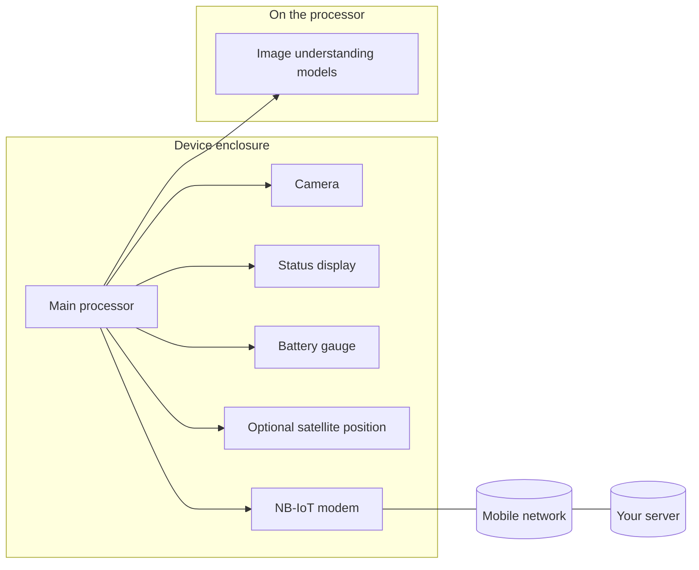

# High-level architecture: ESP32 AI camera device

This note explains, in everyday terms, how this **field device** is put together and what it does from power-on to the next sleep cycle. No prior knowledge of microcontrollers or machine learning is assumed.

## What problem does it solve?

The device is a **small, battery-minded computer with a camera** that can look at a scene (for example the inside of a container), **decide what it sees** using software that runs entirely on the device, and **send a compact report (and optionally a photo)** to a central server over a **narrow cellular data link** (NB-IoT). It is designed to **wake, work briefly, then sleep** so it can run for long periods without constant mains power.

Think of it as: **see → understand locally → report → rest**.

## The main building blocks

| Piece                                     | Role in plain language                                                                                                                                                                                                                                                                                                                         |
| ----------------------------------------- | ---------------------------------------------------------------------------------------------------------------------------------------------------------------------------------------------------------------------------------------------------------------------------------------------------------------------------------------------- |
| **Main board (ESP32-S3)**                 | The “brain”: runs the program, coordinates the camera, display, sensors, and modem, and decides when to sleep. It includes extra **PSRAM** (like a scratch pad for large images).                                                                                                                                                              |
| **Camera**                                | The “eyes”: captures still images that the brain analyzes.                                                                                                                                                                                                                                                                                     |
| **On-device intelligence (Edge Impulse)** | A **trained model** (like a specialist checklist turned into math) that turns a camera image into **labels and confidence scores**—for example how full something looks (**fill level**) and what **material** is likely present. This runs **on the chip**, not in the cloud, so decisions can be made even with a slow or intermittent link. |
| **Small OLED screen**                     | A **local status display** so a person nearby can see what the device is doing (starting up, getting a satellite fix, sending data, sleeping, errors).                                                                                                                                                                                         |
| **NB-IoT modem (Quectel BC95)**           | A **cellular radio** tuned for **low power** and small amounts of data. It speaks to the mobile network; the brain talks to the modem with simple text commands.                                                                                                                                                                               |
| **Battery fuel gauge**                    | Estimates **remaining battery** so that value can be included in telemetry.                                                                                                                                                                                                                                                                    |
| **GNSS (optional GPS-style receiver)**    | Can determine **where** the device is on Earth, which is useful for logistics and for **different sleep intervals** when “at home” vs “away”.                                                                                                                                                                                                  |
| **Load switches (power gating)**          | **Electronic switches** that turn power **on or off** for groups of parts (camera and GNSS on one rail; display and fuel gauge on another). During deep sleep, peripherals are **fully powered down** to save energy.                                                                                                                          |
| **Non-volatile memory (NVS)**             | **Small retained settings** that survive reboots—for example home location, geofence radius, and how long to sleep in different situations.                                                                                                                                                                                                    |

Wi-Fi is **not** used for the main reporting path in this firmware; connectivity for uploads is intended through the **cellular modem**.

## End-to-end flow (one “wake cycle”)

The following is the conceptual pipeline the firmware implements.

1. **Wake**
  The chip wakes from **deep sleep** (very low power) on a **timer**, or after a reset. It carefully **powers up** the camera and related hardware so pins do not accidentally power the camera through stray currents.
2. **Health and schedule**
  It initializes the camera and display, may read battery state, and starts talking to the modem. It can ask the network for **time of day** and, if configured, **skip all work** during a **night window**—going back to sleep until the next **operating hours** window.
3. **Continuous “look and think” loop (background task)**
  A dedicated task repeatedly:
  - allocates memory for one frame,
  - **captures** an image from the camera,
  - runs **two model passes** on that image (fill level and material),
  - updates the **OLED** with the latest guesses and confidences.
4. **When the model is confident enough**
  If classification confidence crosses a threshold, the device treats that as a **meaningful event**: it runs a **main job** that gathers **GNSS** (if enabled), **signal strength**, **network time**, then **opens a TCP connection** to a configured server.
5. **Upload**
  It sends a **text header** that identifies the device and measurement, embeds **telemetry** (battery, GNSS, classification numbers, and placeholders for extra sensors), then sends the **image bytes** in chunks using the modem’s data commands. The server can optionally send **JSON commands** back (for example adjusting sleep behavior or geofence settings), which the device can store in NVS.
6. **Sleep planning**
  Before deep sleep, the firmware may set **how long** the next sleep should last: default interval, or **shorter/longer** depending on whether GNSS says the device is **inside or outside** a stored “home” radius (**geofence**).
7. **Deep sleep**
  The camera is shut down, the modem may be put into a **low-power network mode** (PSM), Wi-Fi and Bluetooth are turned off, pins are put in a safe state, load switches **cut power** to peripherals, and the chip enters **deep sleep** until the timer fires again.

A **safety timeout** also forces sleep if a single wake cycle runs too long, so the device does not stay awake indefinitely if something goes wrong.

## How this looks as a diagram

## Relationship to the “cloud”

The device is **not** continuously streaming video. It sends **structured measurements** and, when configured, **one photo per successful detection cycle**. The **heavy interpretation** (the neural model) is done **on device**; the server receives **results plus evidence** (the image), which keeps **data volume** and **privacy exposure** lower than raw always-on video uplink.

## Power and reliability (why the behavior looks complex)

- **Deep sleep** turns off most of the chip; only a timer (and optional pin wake) brings it back.
- **Peripheral power switching** avoids leaking current into an unpowered camera through signal pins—a common hardware pitfall that this firmware works around with deliberate pin sequencing and **GPIO hold** during sleep.
- **NB-IoT** and **modem power-save modes** trade a bit of responsiveness for **months-style** operation goals on battery, depending on hardware and how often it wakes.

## Where the details live

Application logic—including pin mapping, server address, sleep defaults, and modem behavior—is concentrated in `src/main.cpp`. The **machine learning bundle** (model and runtime) lives under `lib/deploy/` as an **Edge Impulse** export. `README.md` lists the physical board and optional modules for anyone wiring or procuring hardware.

---

*This document describes intent and architecture at a conceptual level. Exact thresholds, ports, and compile-time options may change in firmware; refer to the source and README for authoritative configuration.*